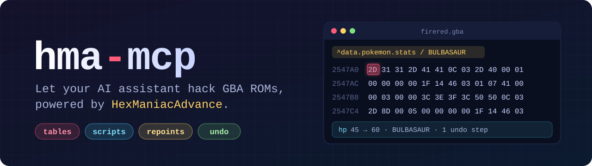
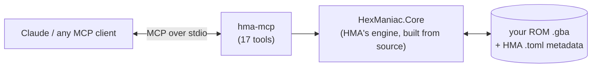

<p align="center">
  
</p>

<p align="center">
  <a href="https://github.com/dewayneku/hma-mcp/actions/workflows/ci.yml"></a>
  
  
  
  <a href="LICENSE"></a>
</p>

<p align="center">
  <b>An <a href="https://modelcontextprotocol.io">MCP</a> server for GBA Pokémon ROM hacking.</b><br>
  Claude (or any MCP client) reads and edits your ROM through the engine behind <a href="https://github.com/haven1433/HexManiacAdvance">HexManiacAdvance</a>:<br>
  the same anchors, tables, script compiler and repointing, with every edit undoable and saves that open straight back up in HMA.
</p>

<p align="center">
  <a href="#quick-start">Quick start</a> ·
  <a href="#what-it-looks-like">Example</a> ·
  <a href="#tools">Tools</a> ·
  <a href="#how-it-works">How it works</a> ·
  <a href="CONTRIBUTING.md">Contributing</a>
</p>

---

## Why

HMA already understands a ROM: it knows where the Pokémon stats table is, which bytes are a type, and how to recompile a script and move it if it grows. hma-mcp gives an AI assistant that same understanding, so you can describe a change in plain words and have it done correctly:

- **No GUI clicking.** The assistant calls HMA's engine directly, without driving the HMA window.
- **Names, not bytes.** Types, moves, species and items read and write as names (`FIRE`, `THUNDERBOLT`). A typo is rejected with suggestions instead of writing garbage.
- **Repointing handled.** When a script or text grows, HMA's engine finds free space, moves it, and updates every pointer.
- **Safe by default.** Nothing touches the disk until you say `save`, the first save backs up your original, and every edit is one undo away.

## What it looks like

These are real results from a FireRed (U) 1.0 test run:

> **You:** Open `C:/hacks/firered.gba` and show me Bulbasaur's base stats.
>
> **Claude:** *(`open_rom`, `read_table`)* BULBASAUR: 45 HP / 49 Atk / 49 Def / 45 Spe / 65 SpA / 65 SpD, GRASS/POISON.
>
> **You:** Make Charmander Fire/Dragon.
>
> **Claude:** *(`write_table_field`)* CHARMANDER `type2`: FIRE → DRAGON. Not saved yet; say "undo" to revert.
>
> **You:** Add a second chime to the Safari Zone time's-up script.
>
> **Claude:** *(`decompile_script`, `compile_script`)* The script grew from 17 to 20 bytes and didn't fit, so HMA moved it from `1BFBC5` to free space at `71A280` and updated its 1 pointer. The anchor `scripts.fromthumb.safari.end` follows it.
>
> **You:** Save.
>
> **Claude:** *(`save`)* Saved `firered.gba` and `firered.toml`. Your original is backed up in `.hma-mcp-backups/`.

## Quick start

You'll need the [.NET 8 SDK](https://dotnet.microsoft.com/download/dotnet/8.0) and a ROM you dumped yourself.

```bash
git clone --recurse-submodules https://github.com/dewayneku/hma-mcp.git
cd hma-mcp
dotnet publish src/HmaMcp -c Release -o ~/.local/share/hma-mcp
```

On Windows, `-o %LOCALAPPDATA%\hma-mcp` is a good spot.

<details>
<summary><b>Why publish outside the repo?</b></summary>

An MCP client keeps the server running, and on Windows a running `.exe` can't be overwritten, so pointing a client at `bin/` breaks your next build. The published folder holds `hma-mcp` (`hma-mcp.exe` on Windows) and a `resources/` folder with HMA's game reference data. Keep them together.

To update: pull, close your MCP client (or start a new session), and run the same `publish` command again.
</details>

**Claude Code:**

```bash
claude mcp add --scope user hma -- "C:/Users/you/AppData/Local/hma-mcp/hma-mcp.exe"
```

`--scope user` makes it available in every project. Servers load when a session starts, so open a new one afterwards.

**Claude Desktop and other MCP clients:**

```json
{
  "mcpServers": {
    "hma": { "command": "C:/Users/you/AppData/Local/hma-mcp/hma-mcp.exe" }
  }
}
```

Then just ask, for example:

- *"Open my ROM and list every table with 'items' in its name."*
- *"Give Pikachu 90 base Sp. Atk and make it Electric/Steel."*
- *"Decompile `scripts.newgame.setflags` and explain what it does."*
- *"Find 512 bytes of free space."*

## Tools

| | Tool | What it does |
|---|---|---|
| 📂 | `open_rom` · `rom_info` · `close_rom` | Open a `.gba`, with HMA's `.toml` metadata if it's there |
| 🔎 | `list_anchors` | Search named anchors: `data.pokemon.stats`, `scripts.…`, `graphics.…` |
| 🧭 | `resolve` | Anchor or address → what's there: type of data, table row and field, pointer count |
| 📋 | `describe_table` · `read_table` | Table layout, and rows as JSON: enums as names, flag sets as lists, packed fields as objects, learnsets and teams as text; filter rows with `where` (`bank=3, map=19`) |
| ✏️ | `write_table_field` | Set one field by row number or row name (`CHARMANDER`), checked against the field's size; also learnsets, TM lists, trainer teams |
| 📜 | `decompile_script` · `compile_script` | Event, battle, animation and trainer-AI scripts, with automatic repointing |
| ⌨️ | `hma_edit` | Type into HMA's hex view using its full edit language (`^anchor`, `<pointer>`, `"text"`) |
| 🧱 | `read_bytes` · `write_bytes` · `find_free_space` | Raw access, for when you need it |
| ↩️ | `undo` · `redo` | One step per tool call, even when HMA records several internally |
| 💾 | `save` | Write the ROM and its `.toml`; the first save backs up the original |

### Games

HMA supports FireRed, LeafGreen, Emerald, Ruby and Sapphire, and hacks of them. **FireRed (U) 1.0 is tested end to end with hma-mcp.** The other games use the same engine but haven't been run through hma-mcp's tests yet. Reports are welcome.

## How it works



- HMA is a git submodule (`external/HexManiacAdvance`), and its core library is compiled from source by `src/HexManiac.Core.Build`, so the server runs exactly the editor's code.
- ROMs open headlessly, the same way HMA's own test suite opens them.
- `compile_script` follows HMA's code editor step for step: compile, move if it grew, update pointers, and keep any sub-scripts the edit left orphaned.
- To move to a newer HMA, run `git submodule update --remote external/HexManiacAdvance`.

Problems found in HMA itself while building this, with fixes, are tracked in [docs/hma-upstream-notes.md](docs/hma-upstream-notes.md).

## Testing

```bash
python tests/smoke.py <path-to-hma-mcp> [path/to/firered.gba]
```

- **With a ROM:** copies it to a temp folder and edits only the copy. Checks reads, writes, enum validation, undo/redo, a script that has to move to free space, `hma_edit`, and a save → reopen round trip (written against FireRed (U) 1.0).
- **Without a ROM:** checks the MCP handshake and tool list, and opens a blank ROM so HMA loads all of its reference data. [CI](.github/workflows/ci.yml) runs this on Windows, Linux and macOS.

## Legal

hma-mcp doesn't include, download or distribute ROMs, and never will. Use it with ROMs you dumped from games you own. Pokémon is a trademark of Nintendo, Creatures Inc. and GAME FREAK inc.; this project isn't affiliated with or endorsed by them.

## Credits

- [**HexManiacAdvance**](https://github.com/haven1433/HexManiacAdvance) by haven1433 and contributors (MIT). All of the ROM knowledge here comes from HMA.
- [MCP C# SDK](https://github.com/modelcontextprotocol/csharp-sdk).

MIT licensed; see [LICENSE](LICENSE).
